  
  

  <a href="https://github.com/vanhhoang?tab=repositories">Repositories</a>
  &nbsp; · &nbsp;
  <a href="https://github.com/vanhhoang?tab=overview">Activity</a>
  &nbsp; · &nbsp;
  <a href="https://github.com/vanhhoang?tab=stars">Stars</a>

  Thanks for stopping by. · <a href="docs/design.md">Data &amp; updates</a>

