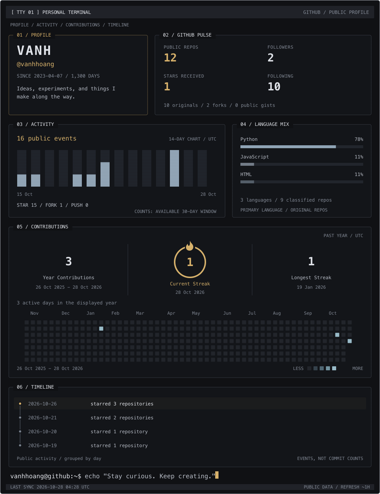
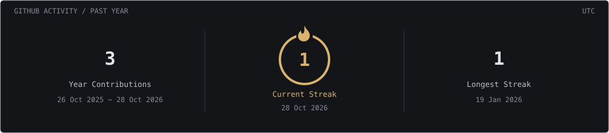

# TUI profile preview

## Custom streak card

- [Full-resolution still image](tui-preview.png)
- [Current animated SVG](../../assets/header.svg)
- [Standalone streak SVG](../../assets/streak.svg)
- [Previous design](previous.svg)

This is a local review snapshot. Contributions appear above the Timeline. The full SVG includes entrance, bar-growth, typing, and cursor animations. Preview files keep the original GitHub data timestamp; the hourly workflow refreshes the profile and standalone streak SVGs.

Layout inspiration: [btop](https://github.com/aristocratos/btop). The SVG renderer is implemented locally with Python; no third-party action or extra secret is required.
