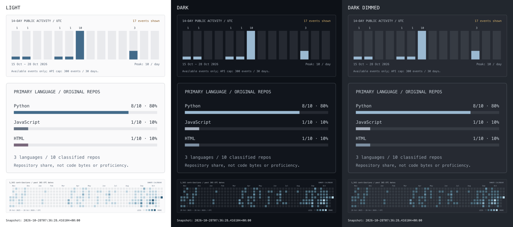
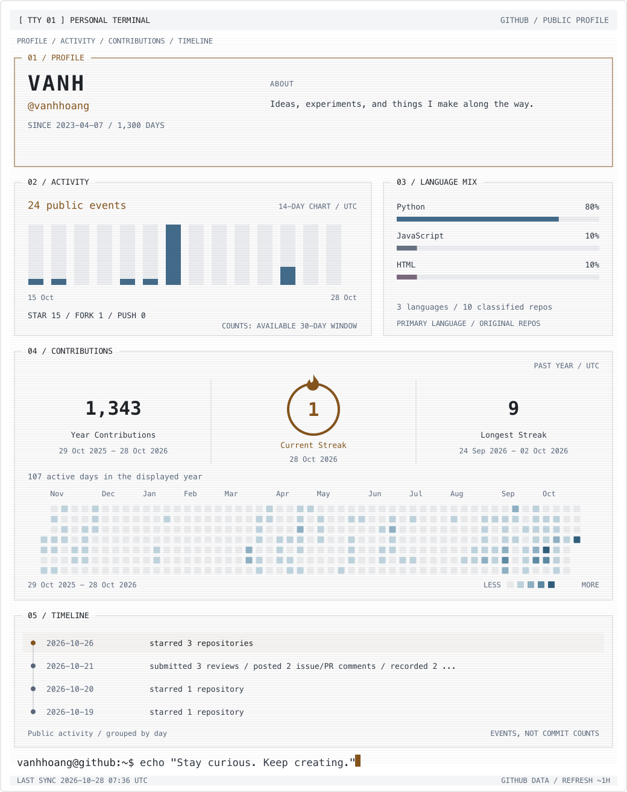

# Theme and terminal previews

## Transparent charts on three backgrounds

The left column uses the light SVG palette. Both dark columns use exactly the same dark SVG files; the different backgrounds remain visible through them. These are rasterized chart previews, not screenshots of GitHub's README renderer. The public README retains the five-pane animated terminal, using the same transparent background and light/dark palettes.

The snapshot timestamp is printed at the bottom of the preview. It is preserved when regenerating offline. Preview PNGs are review artifacts and do not refresh hourly; the profile SVGs and saved JSON do.

## Profile terminal

- [Animated dark terminal](../../assets/header-dark.svg)
- [Animated light terminal](../../assets/header-light.svg)
- [Earlier design](previous.svg)

## Standalone streak visualization

- [Dark SVG](../../assets/streak-dark.svg)
- [Light SVG](../../assets/streak-light.svg)

The five-pane terminal retains entrance, bar-growth, typewriter, cursor and streak-ring animations. Reduced-motion preferences disable the animations. Layout inspiration: [btop](https://github.com/aristocratos/btop).

See [data definitions and maintenance](../design.md) for API sources, hourly scheduling, theme limitations, and local commands.
